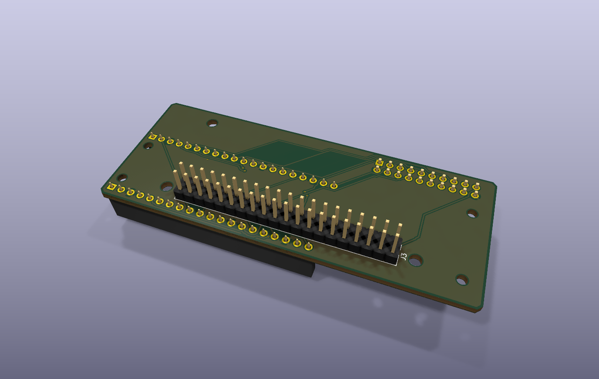
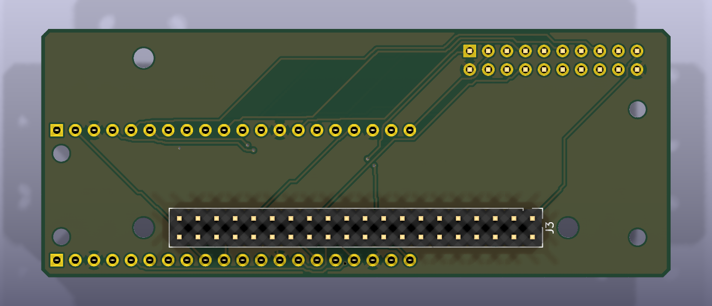
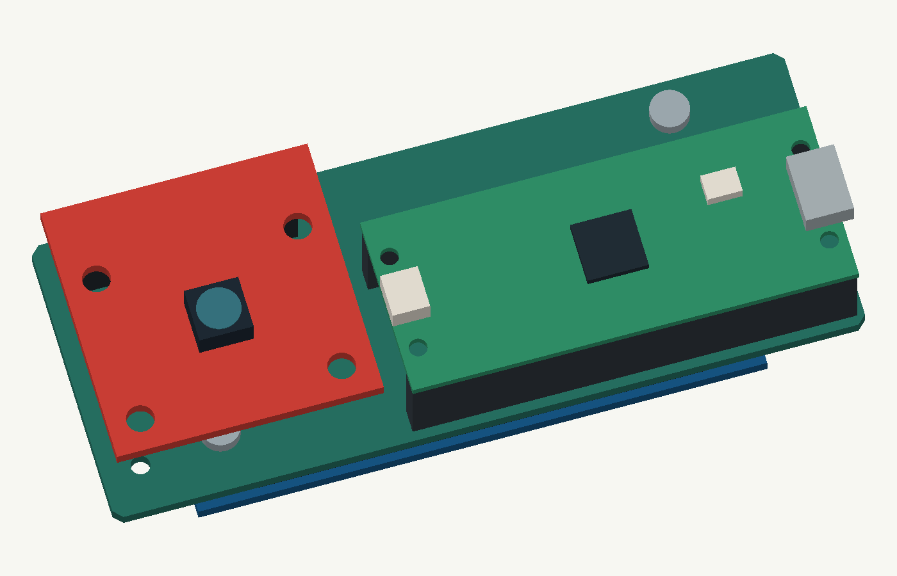

# pico-lcd-cam-carrier

Raspberry Pi Pico 2 H に、Waveshare 1.3inch LCD HAT（240x240 ST7789、ジョイスティックとキー3つ）と OV7675 カメラ（Arducam B0070）をまとめて載せるキャリア基板と、そのケースの KiCad・3D プリント用データです。

| ディレクトリ | 版 | 組み方 |
|---|---|---|
| [hat-carrier/](hat-carrier/README.md) | Rev E | HAT・Pico・カメラをソケットに差す。発注済み、未検証 |
| [pico2h-carrier/](pico2h-carrier/README.md) | Rev D | LCD・Pico・カメラを直接はんだ付けする下書き |

## Rev E の見た目

### キャリア基板



| 表面（HAT 側） | 裏面（Pico・カメラ側） |
|---|---|
|  |  |

表面には HAT を受ける 2x20 オスヘッダ J3、裏面には Pico 用の 1x20 ソケット J1・J2 とカメラ用の 2x10 ソケット J4 をはんだ付けします。

### 組み立てた状態（ケースなし）

| 前面 | 背面 |
|---|---|
|  |  |

前面に 1.3inch LCD HAT、背面に Pico 2 H と OV7675 を差します。部品は寸法だけを合わせた箱のモデルです。

画像の作り直し方:

```sh
K=~/Applications/KiCad/KiCad.app/Contents/MacOS/kicad-cli
$K pcb render -o docs/carrier_iso.png --side top --rotate "-40,0,-20" --perspective --quality high -w 1400 -h 880 hat-carrier/hat_carrier.kicad_pcb
for s in top bottom; do $K pcb render -o docs/carrier_$s.png --side $s --quality high -w 1400 -h 600 --zoom 2.1 hat-carrier/hat_carrier.kicad_pcb; done
# assembled_*.png は hat-carrier/3dprint/build_case.py が書き出す
```

## ピンの割り当て

ファームとの約束事はこの表です。変えるときはファーム側のピン定義も合わせて直します。

| 機能 | Pico GPIO |
|---|---|
| カメラ D0–D7 | GP2–GP9（PIO で連続して読むので並びを崩さない） |
| カメラ PCLK / HREF / VSYNC | GP10 / GP11 / GP12 |
| カメラ SIOD / SIOC（I2C1） | GP14 / GP15 |
| カメラ XCLK（GPOUT0） | GP21 |
| LCD DC / SCK / MOSI（SPI0） | GP16 / GP18 / GP19 |
| LCD RST | GP0 |
| LCD CS | GND に固定（SPI mode 3） |
| ジョイスティック 上 / 下 / 左 / 右 / 押し込み | GP13 / GP17 / GP20 / GP22 / GP26 |
| キー A / B / C | GP27 / GP28 / GP1 |

ボタンは押すと GND に落ちる作りで、プルアップは RP2350 の内部プルアップを使います。

## 出どころ

[bitwasm-signer-pico](https://github.com/bitwasm-project/bitwasm-signer-pico) の `hardware/kicad/` から履歴ごと切り出しました。ケースの前面とキャップは SeedSigner の [Orange Pill](https://github.com/SeedSigner/seedsigner/tree/dev/enclosures/orange_pill)（MIT）を元にしています（`hat-carrier/3dprint/seedsigner/LICENSE.md`）。
