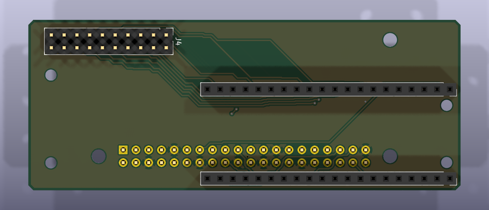
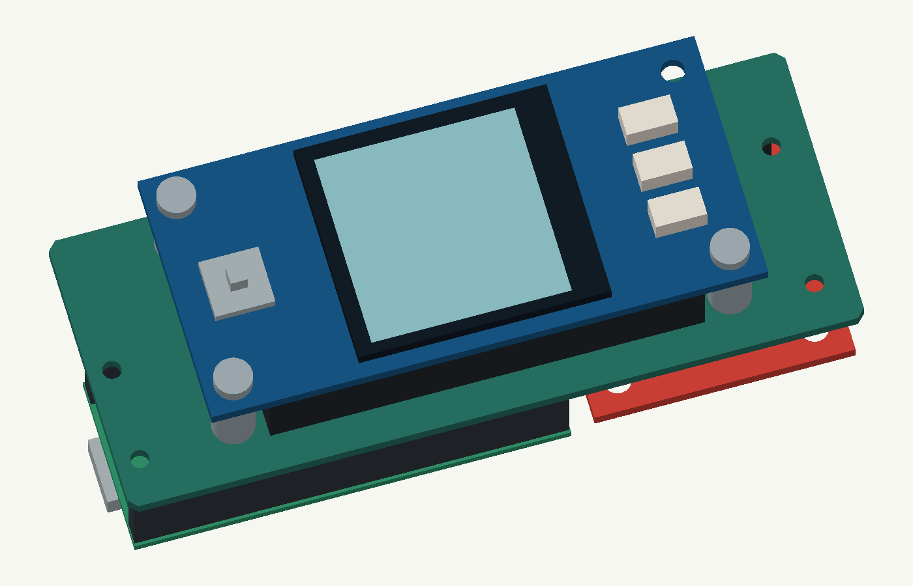

# pico-lcd-cam-carrier

A carrier board and case for building [SeedSigner on the Raspberry Pi Pico 2](https://github.com/habakan/seedsigner-pico)
without soldering. A Raspberry Pi Pico 2 H, a Waveshare 1.3inch LCD HAT (240x240 ST7789, a joystick and three
keys) and an OV7675 camera (Arducam B0070) plug into it. KiCad files, the scripts that generate them, and 3D
print files for the case.

> [!WARNING]
> **Rev E is ordered but not yet tested.** The pin map is the one the firmware uses on a breadboard today, and
> the board passes ERC and DRC, but no assembled Rev E has run yet.

[日本語の README](README.ja.md) · [BOM with prices](BOM.md)

| Directory | Revision | How it goes together |
|---|---|---|
| [hat-carrier/](hat-carrier/README.md) | Rev E | Everything plugs into sockets; no soldering. Ordered, untested |
| [pico2h-carrier/](pico2h-carrier/README.md) | Rev D | A draft where the LCD, the Pico and the camera are soldered on |

The directory READMEs are in Japanese for now.

## Rev E

| Front (HAT side) | Back (Pico and camera side) |
|---|---|
|  |  |

The front takes the HAT on a 2x20 male header (J3). The back has two 1x20 sockets for the Pico (J1, J2) and a
2x10 socket for the camera (J4).

| Front | Back |
|---|---|
|  |  |

The parts in these renders are boxes of the right size, not the real models.

The case's front cover follows SeedSigner's [Orange Pill](https://github.com/SeedSigner/seedsigner/tree/dev/enclosures/orange_pill)
(MIT), so its joystick and key caps fit. About 91 x 39 x 36 mm.

## Pin map

This table is the contract with the firmware. Change the firmware's pin definitions with it.

| Function | Pico GPIO |
|---|---|
| Camera D0-D7 | GP2-GP9 (PIO reads them as one run, so keep the order) |
| Camera PCLK / HREF / VSYNC | GP10 / GP11 / GP12 |
| Camera SIOD / SIOC (I2C1) | GP14 / GP15 |
| Camera XCLK (GPOUT0) | GP21 |
| LCD DC / SCK / MOSI (SPI0) | GP16 / GP18 / GP19 |
| LCD RST | GP0 |
| LCD CS | tied to GND (SPI mode 3) |
| Joystick up / down / left / right / press | GP13 / GP17 / GP20 / GP22 / GP26 |
| Keys A / B / C | GP27 / GP28 / GP1 |

Buttons pull to GND when pressed, against the RP2350's internal pull-ups.

## Origin

Split, with its history, from `hardware/kicad/` in
[bitwasm-signer-pico](https://github.com/bitwasm-project/bitwasm-signer-pico). The case's front cover and caps
come from SeedSigner's Orange Pill (MIT, `hat-carrier/3dprint/seedsigner/LICENSE.md`).

## License

MIT ([LICENSE](LICENSE)). The Orange Pill parts in `hat-carrier/3dprint/seedsigner/` keep SeedSigner's MIT license.
